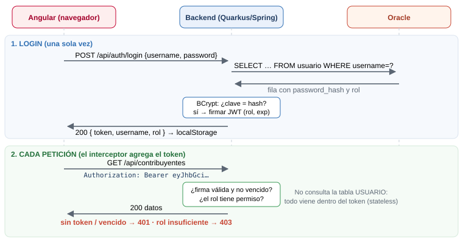

# Cómo funciona el login con JWT

## La analogía: la pulsera de un hotel todo incluido

1. Llegas a **recepción** y muestras tu cédula (usuario + contraseña).
2. Recepción revisa la lista, y si estás, te pone una **pulsera**: dice tu nombre, tu tipo de plan (rol) y hasta cuándo vale (expiración). Tiene un **sello** imposible de falsificar (firma).
3. En el restaurante, en la piscina o en el bar **no vuelven a pedir tu cédula**: solo miran la pulsera.
   - ¿El sello es auténtico y no venció? → pasas.
   - ¿Tu plan incluye el bar? → si es "solo comidas", te dicen que no (**403**).
4. Sin pulsera → ni siquiera entras (**401**).

| Hotel | Nuestra app |
|---|---|
| Recepción | `POST /api/auth/login` |
| Cédula | `{ "username", "password" }` |
| Pulsera | El **token JWT** |
| Plan "todo incluido" / "solo comidas" | Rol `ADMIN` / `VIEW` |
| Sello | Firma del token (RSA en Quarkus, HMAC en Spring) |
| Mostrar la pulsera | Header `Authorization: Bearer <token>` |
| El guardia del bar | `@RolesAllowed` (Quarkus) / `SecurityConfig` (Spring) |

## El flujo completo



El mismo flujo, paso a paso:

```
 Angular                                Backend                           Oracle
 ───────                                ───────                           ──────
 1. Formulario login ──POST /api/auth/login {admin, admin123}──▶
                                         2. SELECT * FROM usuario ──────▶
                                            WHERE username='admin'  ◀──── fila con password_hash
                                         3. BCrypt: ¿"admin123" coincide con el hash?
                                         4. Firma el JWT con { upn: admin, groups: [ADMIN], exp }
                    ◀──200 { token, username, rol }──
 5. Guarda en localStorage

 6. GET /api/contribuyentes
    + Authorization: Bearer eyJ...   ──▶ 7. Verifica firma y expiración (SIN ir a Oracle)
      (lo agrega el interceptor)         8. ¿Rol permitido? sí → ejecuta · no → 403
                    ◀──200 [ ... ]──
```

**Lo importante del paso 7:** el backend **no guarda sesiones**. Todo lo que necesita saber viene dentro del token. Por eso se dice que JWT es **stateless** (sin estado).

## ¿Qué tiene un JWT?

Tres partes en Base64URL separadas por puntos: `HEADER.PAYLOAD.FIRMA`

```json
// HEADER
{ "alg": "RS256", "typ": "JWT" }

// PAYLOAD (los "claims")
{
  "iss": "login-jwt",          // quién lo emitió
  "upn": "admin",              // quién es
  "groups": ["ADMIN"],         // roles
  "rol": "ADMIN",
  "iat": 1794427665,           // cuándo se emitió
  "exp": 1794431265            // cuándo vence (1 hora después)
}
```

> ⚠️ El payload **no está cifrado**, solo codificado: cualquiera lo puede leer en https://jwt.io. **Nunca pongas la contraseña ni datos sensibles en el token.** La firma no lo oculta: solo garantiza que **nadie lo modificó**.

## Quarkus vs Spring: lo mismo con distintas herramientas

| Paso | Quarkus | Spring Boot |
|---|---|---|
| Extensión / starter | `smallrye-jwt` + `smallrye-jwt-build` | `security` + `oauth2-resource-server` |
| Comparar contraseña | `BcryptUtil.matches(clave, hash)` | `passwordEncoder.matches(clave, hash)` |
| Generar token | `Jwt.issuer(..).upn(..).groups(..).sign()` | `jwtEncoder.encode(JwtEncoderParameters.from(header, claims))` |
| Algoritmo de firma | **RS256**: firma con `privateKey.pem` y verifica con `publicKey.pem` | **HS256**: una sola clave secreta (`app.jwt.secret`) |
| Validar token en cada petición | Automático (`mp.jwt.verify.*` en properties) | Automático (`.oauth2ResourceServer(jwt)` en `SecurityConfig`) |
| Reglas por rol | `@RolesAllowed("ADMIN")` en cada método | `.requestMatchers(...).hasRole("ADMIN")` en un solo archivo |
| Endpoint público | `@PermitAll` | `.permitAll()` |

**RS256 vs HS256:** con RS256 (asimétrico) solo quien tiene la clave privada puede firmar, pero cualquiera con la pública puede verificar; sirve cuando varios microservicios validan tokens. HS256 (simétrico) usa la misma clave para todo: es más simple, pero todos los que verifican pueden también firmar.

## Del lado de Angular

| Archivo | Qué hace | Analogía |
|---|---|---|
| `core/auth.service.ts` | Llama al login, guarda el token, sabe el rol (`esAdmin`) | La recepción |
| `core/auth.interceptor.ts` | Agrega `Authorization: Bearer` a **cada** petición; si llega 401, cierra la sesión | Un middleware de Express/Laravel, pero en el cliente |
| `core/auth.guard.ts` | No deja entrar a `/contribuyentes` sin sesión | El portero |
| `login/login.ts` | Formulario reactivo con validaciones | El formulario de registro |

> **Ocultar botones en Angular NO es seguridad.** Cualquiera puede llamar a la API con Postman. La seguridad real está en el backend (403). Ocultar es solo para que la pantalla tenga sentido para cada rol.

## Validaciones del login implementadas

**Cliente (Angular):** usuario obligatorio, de 3 a 50 caracteres y sin espacios; contraseña obligatoria, de 6 a 100 caracteres; errores visibles solo después de tocar el campo; botón deshabilitado mientras se espera; la contraseña se limpia tras un intento fallido; botón Ver/Ocultar contraseña; si ya hay sesión, `/login` redirige; si el token guardado venció, se descarta al cargar.

**Servidor:** `@NotBlank` y `@Size` (400); usuario inexistente, clave incorrecta o usuario inactivo responden **el mismo** 401 "Usuario o contraseña incorrectos", para no revelar qué usuarios existen; las contraseñas se guardan en **BCrypt** y nunca en texto plano; el token vence en 1 hora.

## Generar el hash BCrypt de un usuario nuevo

Cualquiera de estas opciones:

```powershell
# Python
pip install bcrypt
python -c "import bcrypt; print(bcrypt.hashpw(b'miClave', bcrypt.gensalt(10, prefix=b'2a')).decode())"
```

```java
// Java, en un main o test temporal (Spring)
System.out.println(new BCryptPasswordEncoder().encode("miClave"));
// Quarkus
System.out.println(io.quarkus.elytron.security.common.BcryptUtil.bcryptHash("miClave"));
```

```sql
INSERT INTO usuario (username, password_hash, rol) VALUES ('nuevo', '$2a$10$...', 'VIEW');
COMMIT;
```

## Preguntas que te pueden hacer sobre esto

- **¿Dónde guardas el token y qué riesgos tiene?** En `localStorage`, por simplicidad. Si la página tiene una vulnerabilidad XSS, un script malicioso podría leerlo. La alternativa más segura es una cookie `HttpOnly` + `Secure` + `SameSite`, que JavaScript no puede leer, aunque en ese caso hay que proteger contra CSRF.
- **¿Cómo cierras sesión si el backend no guarda nada?** Borrando el token en el cliente. El token sigue siendo válido hasta que vence; por eso se usan tiempos cortos. Para revocarlo de inmediato habría que tener una lista negra o usar *refresh tokens*.
- **¿Qué es un refresh token?** Un segundo token, de vida larga, que solo sirve para pedir un nuevo access token sin volver a escribir la contraseña. Aquí no se implementó para mantener la prueba simple.
- **¿Por qué 401 y no 403 en el login fallido?** 401 significa "no sé quién eres" (no autenticado). 403 significa "sé quién eres, pero no tienes permiso" (no autorizado).
- **¿Por qué desactivar CSRF en Spring?** Porque la API no usa cookies de sesión: el token va en un header que el navegador no envía solo. CSRF ataca justamente a las cookies que se mandan automáticamente.
