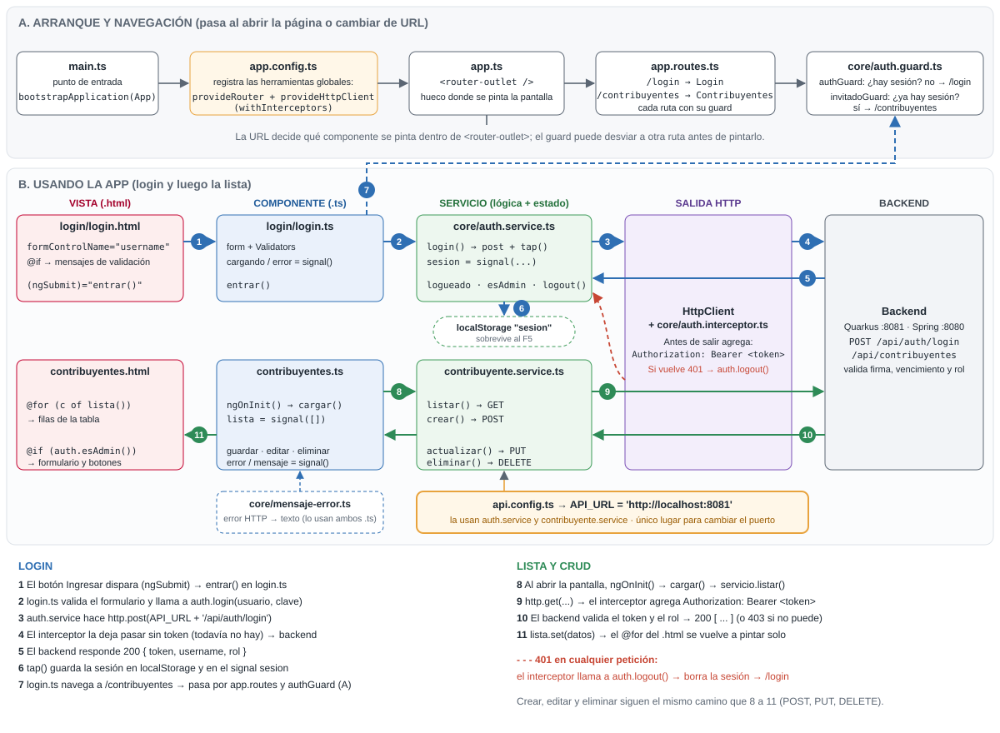

# Mapa de archivos: qué hace cada uno

Los dos backends tienen la **misma forma**: un paquete `auth` (login) y otro `contribuyente` (CRUD).

## backend-quarkus (8081)

```
src/main/resources/
  application.properties   Oracle, JWT, CORS, Swagger            ← datos de conexión aquí
  privateKey.pem           Firma los tokens (solo el backend)
  publicKey.pem            Verifica los tokens
src/main/java/com/hacienda/
  auth/
    Usuario.java           @Entity tabla USUARIO + porUsername()
    LoginRequest.java      DTO {username, password} con @NotBlank
    LoginResponse.java     DTO {token, username, rol, expiraEnSegundos}
    AuthResource.java      POST /login (BCrypt + Jwt.sign) · GET /me
  contribuyente/
    Contribuyente.java     @Entity tabla CONTRIBUYENTE + existeNit()
    ContribuyenteRequest   DTO del POST/PUT con validaciones
    ContribuyenteResource  CRUD + @RolesAllowed por método            ← permisos aquí
```

Patrón: **Panache Active Record**. La entidad trae `findById`, `listAll`, `persist` y `deleteById`, como un Model de Eloquent. No hay Repository ni Service, para no agregar capas en la prueba.

## backend-spring (8080)

```
src/main/resources/
  application.properties   Oracle, clave JWT, CORS                ← datos de conexión aquí
src/main/java/com/hacienda/
  BackendSpringApplication.java   main()
  config/
    SecurityConfig.java           TODA la seguridad: rutas públicas, roles, JWT, CORS, BCrypt  ← permisos aquí
    GlobalExceptionHandler.java   Errores de @Valid -> 400 con la lista de campos
  auth/
    Usuario.java                  @Entity tabla USUARIO
    UsuarioRepository.java        findByUsername (Spring Data arma el SQL por el nombre)
    LoginRequest / LoginResponse  DTOs
    AuthController.java           POST /login (BCrypt + JwtEncoder) · GET /me
  contribuyente/
    Contribuyente.java            @Entity tabla CONTRIBUYENTE
    ContribuyenteRepository.java  JpaRepository + existsByNit
    ContribuyenteRequest.java     DTO con validaciones
    ContribuyenteController.java  CRUD (sin reglas de rol: están en SecurityConfig)
```

Patrón: **Controller → Repository** (Spring Data JPA). En un proyecto grande iría un `@Service` en medio, con las reglas de negocio.

### La misma cosa en los dos

| Concepto | Quarkus | Spring |
|---|---|---|
| Endpoint REST | `@Path` + `@GET` | `@RestController` + `@GetMapping` |
| Parámetro de URL | `@PathParam` | `@PathVariable` |
| Body | parámetro directo | `@RequestBody` |
| Inyección | `@Inject` | constructor (o `@Autowired`) |
| Validar body | `@Valid` | `@Valid` |
| Transacción | `jakarta.transaction.Transactional` | `org.springframework...Transactional` |
| Respuesta con código | `Response.status(409).entity(..)` | `ResponseEntity.status(409).body(..)` |
| Consultas | métodos estáticos en la entidad (Panache) | interfaz `JpaRepository` |

## frontend (Angular 22, 4200)



```
src/app/
  api.config.ts                  URL del backend                     ← CAMBIAR AQUÍ 8081 / 8080
  app.config.ts                  provideHttpClient + interceptor
  app.routes.ts                  /login y /contribuyentes (con guards)
  core/
    auth.service.ts              login, logout, token, esAdmin (signals)
    auth.interceptor.ts          agrega Bearer; 401 => logout
    auth.guard.ts                authGuard (privado) · invitadoGuard (login)
    mensaje-error.ts             entiende los errores de los dos backends
  login/
    login.ts / login.html        formulario reactivo + validaciones
  contribuyentes/
    contribuyente.service.ts     llamadas HTTP del CRUD
    contribuyentes.ts / .html    tabla (todos) + formulario y botones (solo ADMIN)
```

> Angular 22 es **zoneless**: la pantalla se actualiza cuando cambia un `signal()`. Por eso el estado (`lista`, `error`, `cargando`) está en signals. Si asignas una variable normal dentro de un `subscribe`, la vista **no** se refresca.
